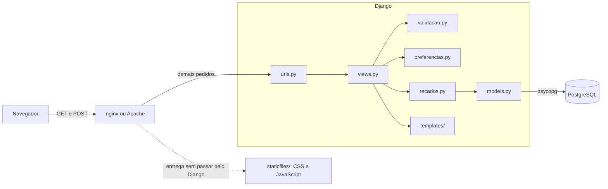

# Estrutura de pastas

A estrutura segue a divisão do Django entre **projeto** e **app**. O projeto,
`mini_mural/`, guarda a configuração e o ponto de entrada WSGI. O app,
`mural/`, guarda tudo o que é do mural: modelo, views, endereços, templates e
arquivos estáticos.

## Diagrama

```mermaid
flowchart TD
    raiz["mini-mural/"]

    raiz --> manage["manage.py"]
    raiz --> projeto["mini_mural/ (projeto)"]
    raiz --> app["mural/ (app)"]
    raiz --> servidor["servidor/"]
    raiz --> sql["sql/"]
    raiz --> docs["docs/"]
    raiz --> config["config.py (local, fora do Git)"]
    raiz --> exemplo["config.exemplo.py"]
    raiz --> req["requirements.txt"]
    raiz --> gerados[".venv/ e staticfiles/ (gerados, fora do Git)"]

    projeto --> settings["settings.py: configuração"]
    projeto --> urlsp["urls.py: inclui mural.urls"]
    projeto --> wsgi["wsgi.py: application"]

    app --> models["models.py: Recado"]
    app --> recados["recados.py: consultas"]
    app --> validacao["validacao.py: regra do texto"]
    app --> preferencias["preferencias.py: cookie da ordem"]
    app --> views["views.py: quatro views"]
    app --> urlsa["urls.py: endereços"]
    app --> templates["templates/: páginas, 404 e 500"]
    app --> static["static/mural/: CSS e JavaScript"]
    app --> tests["tests.py: regras sem banco"]

    servidor --> nginx["nginx.conf"]
    servidor --> service["mini-mural.service: Gunicorn"]
    servidor --> apache["apache.conf: mod_wsgi"]

    sql --> schema["schema.sql"]
    sql --> seed["seed.sql"]
```

## Quem usa quem

As views dependem das funções do app; só `recados.py` usa o modelo, e só o
modelo fala com o banco. O servidor web entrega os estáticos sem passar pelo
Django.

## O que mora em cada arquivo

| Arquivo | Conteúdo | Muda quando |
|---|---|---|
| `manage.py` | Linha de comando do Django: `test`, `collectstatic`, `shell` | Raramente |
| `mini_mural/settings.py` | Apps, middlewares, banco, fuso, estáticos e log, com os valores locais lidos de `config.py` | Entra um app, um middleware ou uma configuração |
| `mini_mural/urls.py` | Inclui as rotas do app `mural` | Entra outro app |
| `mini_mural/wsgi.py` | A `application` que o Gunicorn e o mod_wsgi chamam | Raramente |
| `mural/models.py` | O modelo `Recado`, com `managed = False` | O `schema.sql` muda |
| `mural/recados.py` | `listar_recados()`, `buscar_recado()`, `publicar_recado()`, `arquivar_recado()` e `resumir_recados()` | Uma consulta muda |
| `mural/validacao.py` | `validar_recado()`, `LIMITE_DO_RECADO` e `normalizar_quebras_de_linha()` | A regra do texto muda |
| `mural/preferencias.py` | `ler_ordem()`, `salvar_ordem()` e a lista `ORDENS` | Surge outra preferência ou outra ordem |
| `mural/views.py` | As views `mural`, `recado`, `arquivar` e `sobre`, e `redirecionar()` | O comportamento de uma página muda |
| `mural/urls.py` | Os quatro endereços e seus nomes | Um endereço muda |
| `mural/templates/mural/` | `base.html` com a navegação e uma página por view, além da página de recado ausente | O HTML de uma página muda |
| `mural/templates/404.html` e `500.html` | Páginas de endereço inexistente e de erro do servidor | O texto dessas páginas muda |
| `mural/static/mural/css/estilo.css` | Cores, espaços e tamanhos, definidos como variáveis CSS no topo | A aparência muda |
| `mural/static/mural/js/mural.js` | Contador de caracteres e aviso de erro antes do envio | O comportamento do formulário no navegador muda |
| `mural/tests.py` | Testes das regras, sem banco | Uma regra muda |
| `servidor/nginx.conf` | Site do nginx: porta, `/static/` e repasse ao Gunicorn | A pasta ou a porta do site muda |
| `servidor/mini-mural.service` | Unidade do systemd que liga o Gunicorn | O número de processos ou a pasta muda |
| `servidor/apache.conf` | Site do Apache com mod_wsgi | A pasta ou a porta do site muda |
| `sql/schema.sql` | Tabela, restrições e índice | O modelo de dados muda |
| `sql/seed.sql` | Os três recados de exemplo | Os exemplos mudam |
| `config.exemplo.py` | Modelo da configuração local | Entra uma configuração nova |
| `requirements.txt` | Django, psycopg e Gunicorn, com as versões aceitas | Uma dependência entra ou muda de versão |
