# Como a aplicação funciona

Este documento descreve o que a aplicação faz e o caminho de cada pedido, do
navegador ao banco e de volta. As escolhas por trás desse caminho estão em
[decisoes.md](decisoes.md).

## As quatro partes

A aplicação tem quatro partes, e cada uma tem uma responsabilidade.

| Parte | Onde roda | Responsabilidade |
|---|---|---|
| Navegador | Na máquina de quem usa | Mostra o HTML, aplica o CSS e roda o `mural.js`, que avisa erros do formulário antes do envio |
| Servidor web (nginx ou Apache) | No servidor | Recebe a conexão, entrega direto os arquivos de `/static/` e passa os outros pedidos ao Django |
| Django (no Gunicorn ou no mod_wsgi) | No servidor, em processos Python | Executa a view do endereço pedido: aplica as regras, consulta o banco e monta o HTML da resposta |
| PostgreSQL | No servidor de banco, que pode ser a mesma máquina | Guarda usuários, sessões e recados, e recusa dados que quebram as restrições das tabelas |

Com nginx, o Django roda no Gunicorn, um processo separado que escuta em
`127.0.0.1:8000`, e o nginx repassa os pedidos a ele por HTTP. Com Apache, o
mod_wsgi cria os processos Python e os administra de dentro do próprio Apache.
Nos dois casos, a porta de entrada do Django é a `application` de
`mini_mural/wsgi.py`, e o código do projeto é o mesmo.

O navegador nunca fala com o banco. Todo acesso a dados passa pelo Django, e é
nele que mora a regra de negócio: só quem entrou publica e arquiva, o texto do
recado tem de 1 a 280 caracteres, todo recado nasce publicado e privado, e só
um recado publicado pode ser arquivado.

## Funcionalidades

São seis funcionalidades: criar conta e entrar, publicar, listar, abrir o
detalhe, arquivar e escolher a ordem do mural. Todas exigem login, menos a
leitura de um recado público.

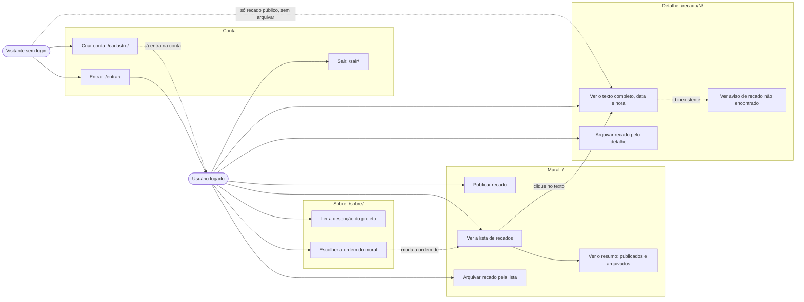

## Endereços

O arquivo `mural/urls.py` liga cada endereço a uma view de `mural/views.py`.

| Endereço | Método | Login | View | O que faz | Resposta |
|---|---|---|---|---|---|
| `/` | GET | Sim | `mural` | Mostra o formulário, o resumo e a lista na ordem do cookie | 200 com HTML |
| `/` | POST | Sim | `mural` | Valida e grava um recado novo, público ou privado | 303 para `/` se válido, 422 com a página e a mensagem se inválido |
| `/recado/N/` | GET | Só para recado privado | `recado` | Mostra um recado | 200, ou 404 se o recado não existe |
| `/recado/N/arquivar/` | POST | Sim | `arquivar` | Arquiva o recado `N` | 303 para a lista ou para o detalhe; 405 se chegar por GET |
| `/sobre/` | GET e POST | Sim | `sobre` | Mostra e grava a ordem no cookie | 200; 303 para `/sobre/?salvo=1` depois de gravar |
| `/entrar/` | GET e POST | Não | `Entrar` (`LoginView`) | Mostra o formulário e confere usuário e senha | 302 para `next` ou `/` se conferem, 422 se não |
| `/cadastro/` | GET e POST | Não | `cadastro` | Cria a conta e já entra nela | 303 para `/` se criou, 422 com as mensagens se não |
| `/sair/` | POST | Sim | `LogoutView` | Apaga a sessão | 302 para `/entrar/`; 405 se chegar por GET |

Uma view com `@login_required` responde 302 para `/entrar/?next=` seguido do
endereço pedido, e o login devolve a pessoa a esse endereço.

Um endereço sem rota, como `/recado/abc/` ou `/qualquer-coisa`, recebe 404 do
próprio Django, com o template `404.html`. Todo POST sem o token CSRF recebe
403, e um pedido com nome de site fora de `ENDERECOS_ACEITOS` recebe 400.

## O caminho de um pedido dentro do Django

Antes de chegar à view, o pedido passa pelos middlewares de `settings.py`. O de
sessão lê o cookie `sessionid` e carrega a sessão do banco, o de CSRF confere o
token dos POST, e o de autenticação preenche `request.user` com o usuário
logado, ou com um usuário anônimo. O Django então procura o
endereço em `urls.py` e chama a view. A view usa as funções de `recados.py`,
`validacao.py` e `preferencias.py` e termina com `render()`, que monta o HTML a
partir de um template, ou com `redirecionar()`.

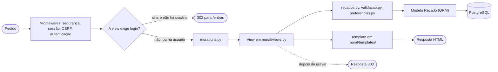

### Abrir o mural

O primeiro diagrama mostra o servidor web separado do Django. Os pedidos de
página passam pelos dois; os de CSS e JavaScript param no servidor web, que lê
o arquivo de `staticfiles/` sem acionar o Python.

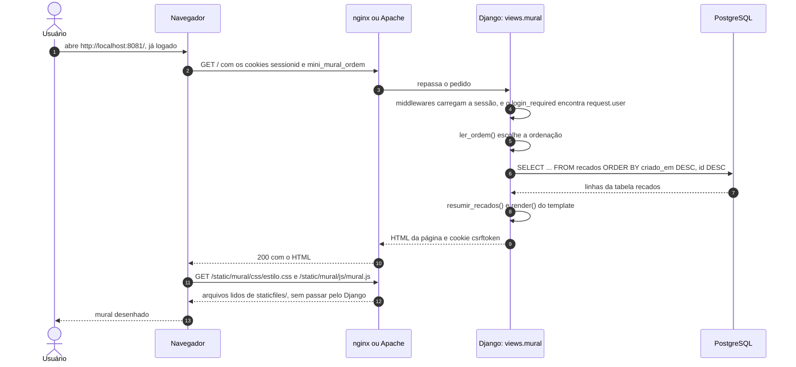

Os diagramas seguintes juntam servidor web e Django em um participante só, para
destacar o que o código do projeto faz.

### Publicar um recado válido

Depois de gravar, a view responde 303 sem HTML, e o navegador faz um GET novo.
Esse padrão se chama **POST/redirect/GET**. Como o último pedido da página foi
um GET, recarregar depois de publicar repete só a leitura, e o recado é gravado
uma vez.

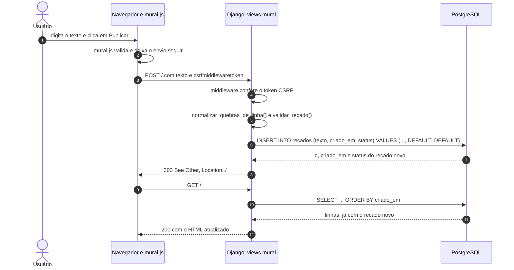

### Publicar um texto inválido

O texto inválido pode ser barrado em dois lugares. Com JavaScript ligado, o
`mural.js` cancela o envio, mostra a mensagem e devolve o foco ao campo; nenhum
pedido sai do navegador. Sem JavaScript, ou com um pedido montado à mão, a view
faz a mesma conferência e responde 422 com o formulário preenchido. Nos dois
casos o banco não recebe nada.

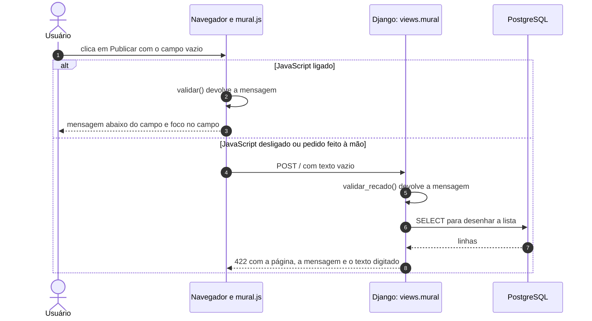

### Arquivar um recado

O botão "Arquivar" é um formulário que envia POST para `/recado/N/arquivar/`.
Arquivar muda dados, por isso usa POST: um link comum seria um GET, e um GET
pode ser disparado por um buscador ou por uma pré-carga do navegador. O
decorador `@require_POST` responde 405 a qualquer outro método.

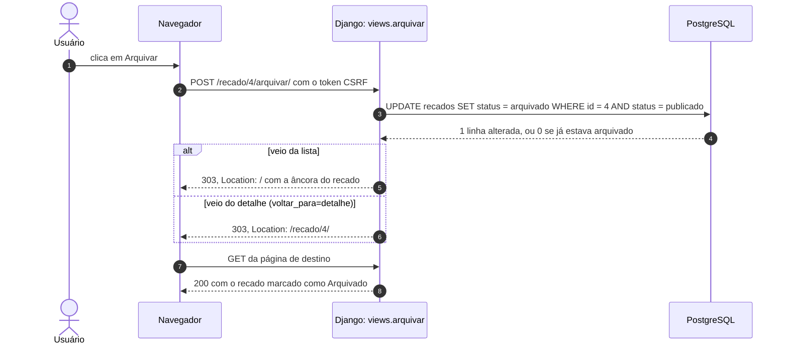

### Escolher a ordem do mural

A ordem é a única informação que fica no navegador. A view grava um cookie, e o
navegador o devolve em todo pedido seguinte. A view `sobre` nem consulta o
banco.

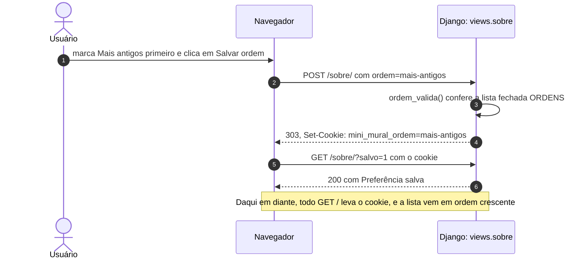

## Login e acesso

O login usa o `django.contrib.auth` e as sessões do Django. No login, o Django
grava o id do usuário na sessão, guardada na tabela `django_session`, e o
navegador recebe só o identificador da sessão, no cookie `sessionid`. Em cada
pedido seguinte, os middlewares leem o cookie, carregam a sessão e preenchem
`request.user`.

### Entrar

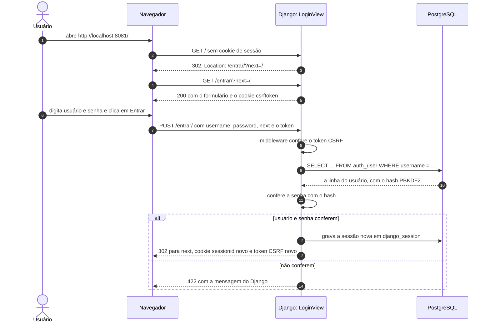

No login, o Django troca o identificador da sessão e o token CSRF. A troca
protege contra a **fixação de sessão**: se alguém conseguisse plantar um
identificador no navegador da vítima antes do login, esse identificador deixa
de valer quando ela entra. O parâmetro `next` só é seguido se apontar para o
próprio site.

### Criar conta

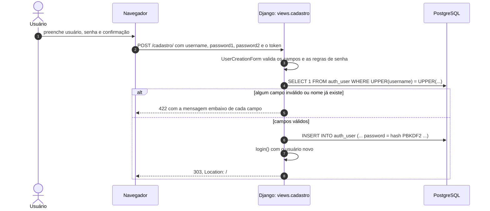

### Recado público e recado privado sem login

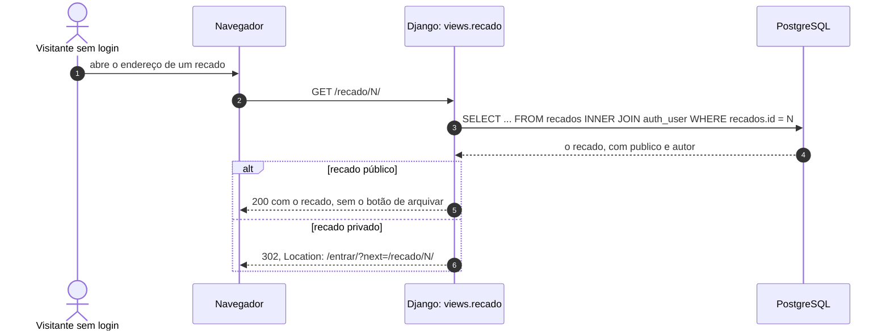

## Validação em três camadas

A regra do texto do recado aparece em três lugares, com papéis diferentes.

| Camada | Onde | Papel |
|---|---|---|
| Navegador | `maxlength` no `<textarea>` e `validar()` em `mural/static/mural/js/mural.js` | Conforto: avisa antes do envio e impede digitar além do limite |
| Django | `validar_recado()` em `mural/validacao.py` | Regra que vale: decide se o recado é gravado e qual mensagem a pessoa vê |
| Banco | restrições `CHECK` em `sql/schema.sql` | Última barreira: recusa a gravação se um defeito no código deixar passar um texto inválido |

O navegador não é confiável como barreira, porque qualquer pessoa pode enviar um
POST com `curl` sem passar pelo formulário. Por isso o Django repete a
conferência.

Um detalhe de contagem: o navegador envia cada quebra de linha do `<textarea>`
como `\r\n`, dois caracteres, mas o `maxlength` conta como um. A função
`normalizar_quebras_de_linha()` troca `\r\n` por `\n` antes de validar, e assim
o Python conta igual ao navegador. O `len()` do Python conta caracteres, e cada
letra acentuada conta uma vez, mesmo ocupando dois bytes em UTF-8.

## Cuidados de segurança

A tabela liga cada risco ao cuidado que o evita e ao lugar onde ele está.

| Risco | Cuidado | Onde |
|---|---|---|
| Injeção de SQL | O ORM manda todo valor como parâmetro; a ordem escolhe entre dois `order_by` fixos | `mural/recados.py` |
| Script injetado em recado (XSS) | Os templates do Django escapam toda variável por padrão; o único `safe` é no texto de ajuda da senha, que o próprio Django monta | `mural/templates/` |
| Formulário enviado por outro site (CSRF) | `CsrfViewMiddleware` e `` em todo formulário | `settings.py` e templates |
| Redirecionamento para site externo | O destino depois de arquivar sai de duas opções fixas, nunca do pedido | `views.arquivar` |
| Mudança de dados por link | Publicar e salvar a ordem só gravam em POST; arquivar tem `@require_POST`, e a `LogoutView` só aceita POST | `mural/views.py` e `mural/urls.py` |
| Senha vazada do banco | `auth_user` guarda só o hash PBKDF2, com sal | `django.contrib.auth` |
| Fixação de sessão | O login troca o identificador da sessão | `django.contrib.auth` |
| Redirecionamento externo depois do login | A `LoginView` só segue um `next` do próprio site | `views.Entrar` |
| Senha fraca | Regras de `AUTH_PASSWORD_VALIDATORS`: tamanho mínimo, senha comum, só números, parecida com o nome | `settings.py` |
| Cabeçalho `Host` forjado | `ALLOWED_HOSTS` recusa nomes fora da lista com 400 | `config.py` |

Um risco ficou sem cuidado: não há limite de tentativas de login, e alguém
pode testar senhas à vontade. A decisão D25, em [decisoes.md](decisoes.md),
registra essa consequência.

## Com Docker

O `compose.yaml` monta as mesmas partes em contêineres. O `web` faz o papel do
servidor web, o `app` roda o Django no Gunicorn e o `banco` roda o PostgreSQL.
O navegador continua falando só com o nginx, pela porta 8081 da sua máquina.

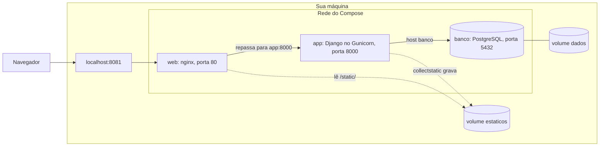

Dentro da rede do Compose, cada serviço é encontrado pelo próprio nome. Por
isso o `docker/nginx.conf` repassa os pedidos para `app:8000`, e o
`docker/config.py` usa `banco` como endereço do PostgreSQL. Só a porta do nginx
é publicada na sua máquina; o Gunicorn e o PostgreSQL ficam alcançáveis apenas
de dentro da rede.

Na primeira subida, com o volume `dados` vazio, a imagem do PostgreSQL cria o
usuário e o banco `mini_mural`, sem tabelas. O `app` só liga depois que o banco
responde ao `pg_isready`, conferido pelo `healthcheck` do `compose.yaml`. A
cada partida, ele roda, em ordem:

1. `migrate`, que cria ou atualiza as tabelas do `auth` e das sessões;
2. `carregar_esquema --se-ausente --exemplos`, que cria a tabela `recados`, o
   usuário `exemplo` e os recados de exemplo, só se a tabela ainda não existe;
3. `collectstatic`, que copia CSS e JavaScript para o volume `estaticos`;
4. o Gunicorn.

A tabela `recados` aponta para `auth_user`, por isso ela vem depois do
`migrate` e não pode ser criada pelo PostgreSQL na primeira partida.

## Quando algo dá errado

Uma exceção não tratada, como o banco desligado ou um SQL com defeito, faz o
Django responder 500 com o template `500.html`, sem informação interna. O
`LOGGING` de `settings.py` manda o rastro completo para a saída de erro, que
vai para o diário do systemd (`journalctl -u mini-mural`) com Gunicorn, ou para
o `mini-mural-erro.log` com Apache, ou para a saída do contêiner com Docker
(`docker compose logs app`). Se a página "Algo deu errado" aparecer,
leia o log.

O `DEBUG = True` no `config.py` troca essas páginas pela página de depuração do
Django, com o código e as variáveis. Ela ajuda a achar um defeito na sua
máquina, mas mostra detalhes internos a quem abrir o site.
