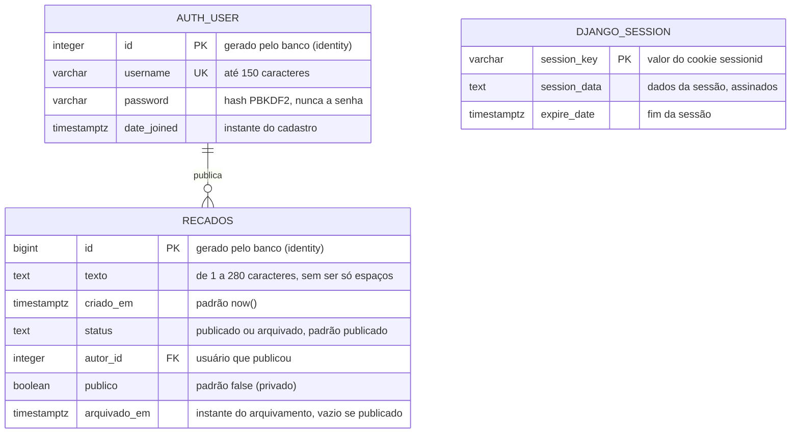
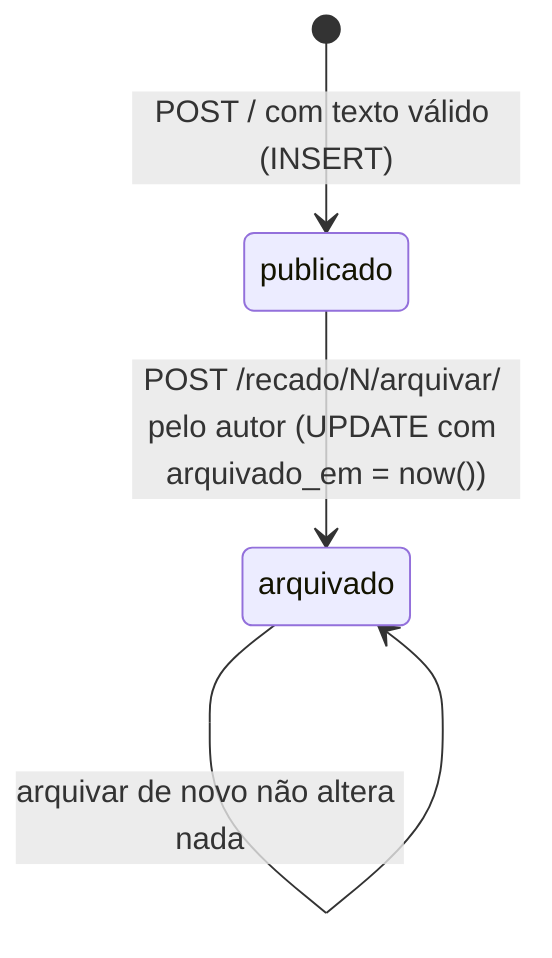

# Modelo de dados

O banco tem tabelas de duas origens. A tabela `recados` vem de `sql/schema.sql`
(decisão D8). As tabelas de usuários e de sessões vêm das migrations do próprio
Django (decisão D23); destas, o mural usa `auth_user` e `django_session`. A
preferência de ordem do mural não fica no banco: ela vive no cookie
`mini_mural_ordem` do navegador (decisão D11 em [decisoes.md](decisoes.md)).

## Diagrama

O diagrama mostra só as colunas de `auth_user` que o mural usa. A tabela tem
outras, como `email`, `is_staff` e `last_login`, que o Django cria e o mural
ignora.

Cada usuário publica zero ou mais recados, e cada recado tem exatamente um
autor. O id do usuário logado fica dentro de `session_data`, e por isso a
tabela `django_session` dispensa chave estrangeira para `auth_user`.

O que fica fora do banco também faz parte do estado da aplicação:

| Onde | Nome | Conteúdo | Padrão |
|---|---|---|---|
| Cookie do navegador | `sessionid` | Identificador da sessão; os dados ficam em `django_session` | Criado no login |
| Cookie do navegador | `csrftoken` | Token da proteção CSRF; o projeto não lê nem escreve este cookie diretamente | Criado na primeira página com formulário |
| Cookie do navegador | `mini_mural_ordem` | `mais-recentes` ou `mais-antigos` | `mais-recentes` quando ausente ou desconhecido |

## Colunas de `recados`

| Coluna | Tipo | Regra | Quem garante |
|---|---|---|---|
| `id` | `bigint` | Único, gerado em sequência | `GENERATED ALWAYS AS IDENTITY` e `PRIMARY KEY` |
| `texto` | `text` | Não vazio depois de tirar espaços; até 280 caracteres | `validar_recado()` no Django e os `CHECK` `recado_texto_preenchido` e `recado_texto_ate_280` |
| `criado_em` | `timestamptz` | Instante da gravação, com fuso | `DEFAULT now()` |
| `status` | `text` | `publicado` ou `arquivado` | `DEFAULT 'publicado'` e o `CHECK` `recado_status_valido` |
| `autor_id` | `integer` | Um usuário que existe; o tipo acompanha o de `auth_user.id` | `REFERENCES auth_user (id)`; a view grava `request.user` |
| `publico` | `boolean` | `true` deixa ler sem login enquanto o recado está publicado | `DEFAULT false`; a view grava a caixa "Público" do formulário |
| `arquivado_em` | `timestamptz` | Preenchido se e só se o recado está arquivado | `Now()` no `update()` de `arquivar_recado()` e o `CHECK` `recado_arquivado_com_data` |

O `CHECK recado_arquivado_com_data` compara duas condições,
`(status = 'arquivado') = (arquivado_em IS NOT NULL)`. Ele recusa um recado
arquivado sem data e um recado publicado com data, então as duas colunas nunca
se contradizem.

O `REFERENCES` impede apagar um usuário que tem recados. O índice
`recados_criado_em` atende ao `ORDER BY criado_em` da lista. Com três recados
ele não faz diferença; com milhares, evita que o banco ordene a tabela inteira a
cada abertura do mural.

## O modelo `Recado`

O modelo de `mural/models.py` descreve a tabela `recados` para o ORM. Como ela
vem do `schema.sql`, o modelo tem `managed = False`: o Django usa a tabela como
está e nunca a cria, altera ou apaga (decisão D8). O usuário é o modelo `User`
do próprio `django.contrib.auth`, com tabela criada pelo `migrate`.

| Campo do modelo | Coluna | Observação |
|---|---|---|
| `id = BigAutoField(primary_key=True)` | `id bigint` | O Django não envia o id no `INSERT` e recebe o valor gerado |
| `texto = TextField()` | `texto text` | |
| `criado_em = DateTimeField(db_default=Now())` | `criado_em timestamptz` | O `db_default` faz o Django enviar `DEFAULT`, e o banco preenche |
| `status = TextField(db_default='publicado')` | `status text` | Idem; as constantes `Recado.PUBLICADO` e `Recado.ARQUIVADO` evitam escrever o texto solto no código |
| `autor = ForeignKey(AUTH_USER_MODEL, on_delete=PROTECT)` | `autor_id integer` | O Django acrescenta `_id` ao nome do campo para achar a coluna |
| `publico = BooleanField(db_default=False)` | `publico boolean` | |
| `arquivado_em = DateTimeField(null=True)` | `arquivado_em timestamptz` | `None` enquanto o recado está publicado |
| `Meta.db_table = 'recados'` | nome da tabela | Sem isso, o Django procuraria `mural_recado` |

O modelo tem ainda três regras sem banco: `leitura_publica`, verdadeira para
recado público e publicado; `pode_ser_visto_por(usuario)`, que deixa o
arquivado só para o autor; e `pode_ser_arquivado_por(usuario)`, verdadeira só
para o autor de um recado publicado. Views e templates usam as duas para decidir
quem lê e quem vê o botão de arquivar.

Quando o `schema.sql` muda, o modelo muda junto, à mão. Nada no projeto confere
se os dois concordam.

## Ciclo de vida de um recado

Um recado só anda em uma direção: a aplicação não oferece desarquivar nem
apagar. O campo `publico` é decidido na publicação e não muda depois. Só o
autor arquiva, e o arquivamento grava o instante em `arquivado_em`. Depois de
arquivado, o recado só aparece para o autor, mesmo que seja público.

## Consultas que a aplicação faz

As consultas de recados ficam todas em `mural/recados.py`. A coluna da direita
mostra o SQL que o Django gera, capturado do próprio banco. Os valores seguem
separados do texto da consulta, como parâmetros, representados por `%s`.

| Função | ORM | SQL gerado (resumido) |
|---|---|---|
| `listar_recados('mais-recentes', usuario)` | `Recado.objects.select_related('autor').filter(Q(status='publicado') \| Q(autor=usuario)).order_by('-criado_em', '-id')` | `SELECT recados.*, auth_user.* FROM recados INNER JOIN auth_user ON recados.autor_id = auth_user.id WHERE (status = 'publicado' OR autor_id = %s) ORDER BY criado_em DESC, id DESC` |
| `listar_recados('mais-antigos')` | o mesmo, com `order_by('criado_em', 'id')` | `... ORDER BY criado_em ASC, id ASC` |
| `listar_recados_publicos(ordem)` | o mesmo, com `.filter(publico=True, status='publicado')` | `... WHERE publico AND status = 'publicado' ORDER BY ...` |
| `buscar_recado(id)` | `Recado.objects.select_related('autor').filter(id=id).first()` | `... WHERE recados.id = %s ORDER BY recados.id ASC LIMIT 1` |
| `publicar_recado(texto, autor, publico)` | `Recado.objects.create(texto=texto, autor=autor, publico=publico)` | `INSERT INTO recados (texto, criado_em, status, autor_id, publico) VALUES (%s, DEFAULT, DEFAULT, %s, %s) RETURNING id, criado_em, status, publico` |
| `arquivar_recado(id, autor)` | `Recado.objects.filter(id=id, autor=autor, status='publicado').update(status='arquivado', arquivado_em=Now())` | `UPDATE recados SET status = 'arquivado', arquivado_em = NOW() WHERE id = %s AND autor_id = %s AND status = 'publicado'` |

O `select_related('autor')` traz o autor na mesma consulta, com um `JOIN`. Sem
ele, o template faria uma consulta a mais por recado ao mostrar o nome. As
consultas de login, cadastro e sessão são do `django.contrib.auth` e do
`django.contrib.sessions`; o cadastro, por exemplo, confere nome repetido com
`SELECT 1 FROM auth_user WHERE UPPER(username) = UPPER(%s)`.

O desempate por `id` na ordenação garante uma ordem estável quando dois recados
têm o mesmo `criado_em`. Para ver o SQL de qualquer consulta, imprima
`str(consulta.query)` no `python manage.py shell`.
