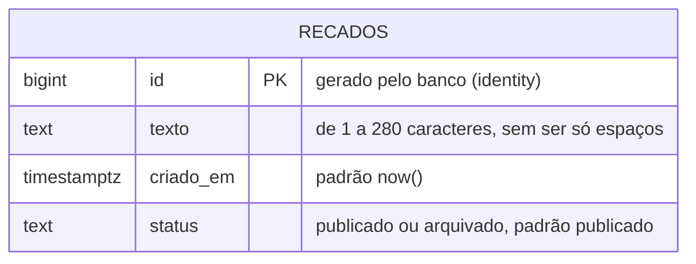
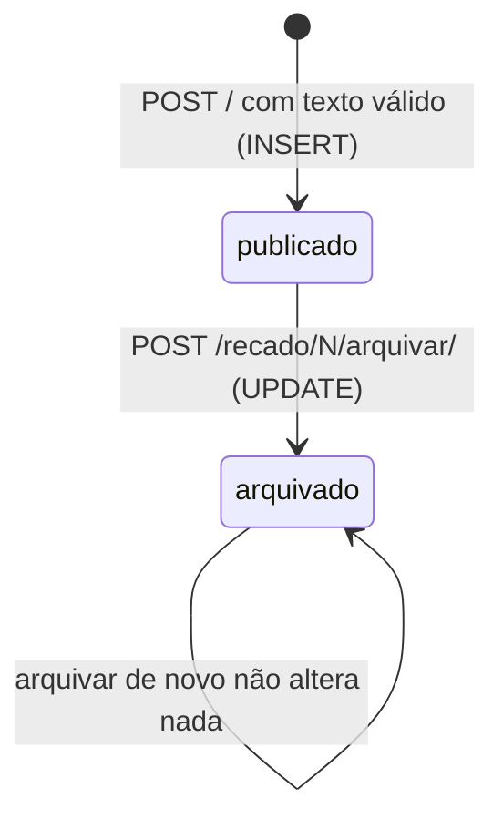

# Modelo de dados

O banco tem uma tabela, `recados`, criada por `sql/schema.sql`. A preferência de
ordem do mural não fica no banco: ela vive no cookie `mini_mural_ordem` do
navegador (decisão D11 em [decisoes.md](decisoes.md)).

## Diagrama

O cookie aparece fora do diagrama porque não é uma tabela, mas faz parte do
estado da aplicação:

| Onde | Nome | Valores | Padrão |
|---|---|---|---|
| Cookie do navegador | `mini_mural_ordem` | `mais-recentes`, `mais-antigos` | `mais-recentes` quando ausente ou desconhecido |

O Django grava ainda o cookie `csrftoken`, que guarda o token da proteção CSRF.
O projeto não lê nem escreve esse cookie diretamente.

## Colunas

| Coluna | Tipo | Regra | Quem garante |
|---|---|---|---|
| `id` | `bigint` | Único, gerado em sequência | `GENERATED ALWAYS AS IDENTITY` e `PRIMARY KEY` |
| `texto` | `text` | Não vazio depois de tirar espaços; até 280 caracteres | `validar_recado()` no Django e os `CHECK` `recado_texto_preenchido` e `recado_texto_ate_280` |
| `criado_em` | `timestamptz` | Instante da gravação, com fuso | `DEFAULT now()` |
| `status` | `text` | `publicado` ou `arquivado` | `DEFAULT 'publicado'` e o `CHECK` `recado_status_valido` |

O índice `recados_criado_em` atende ao `ORDER BY criado_em` da lista. Com três
recados ele não faz diferença; com milhares, evita que o banco ordene a tabela
inteira a cada abertura do mural.

## O modelo `Recado`

O modelo de `mural/models.py` descreve a mesma tabela para o ORM. Como ela vem
do `schema.sql`, o modelo tem `managed = False`: o Django usa a tabela como
está e nunca a cria, altera ou apaga (decisão D8).

| Campo do modelo | Coluna | Observação |
|---|---|---|
| `id = BigAutoField(primary_key=True)` | `id bigint` | O Django não envia o id no `INSERT` e recebe o valor gerado |
| `texto = TextField()` | `texto text` | |
| `criado_em = DateTimeField(db_default=Now())` | `criado_em timestamptz` | O `db_default` faz o Django enviar `DEFAULT`, e o banco preenche |
| `status = TextField(db_default='publicado')` | `status text` | Idem; as constantes `Recado.PUBLICADO` e `Recado.ARQUIVADO` evitam escrever o texto solto no código |
| `Meta.db_table = 'recados'` | nome da tabela | Sem isso, o Django procuraria `mural_recado` |

Quando o `schema.sql` muda, o modelo muda junto, à mão. Nada no projeto confere
se os dois concordam.

## Ciclo de vida de um recado

Um recado só anda em uma direção: a aplicação não oferece desarquivar nem
apagar.

## Consultas que a aplicação faz

Estas são todas as consultas do projeto, todas em `mural/recados.py`. A coluna
da direita mostra o SQL que o Django gera, capturado do próprio banco. Os
valores seguem separados do texto da consulta, como parâmetros, representados
por `%s`.

| Função | ORM | SQL gerado (resumido) |
|---|---|---|
| `listar_recados('mais-recentes')` | `Recado.objects.order_by('-criado_em', '-id')` | `SELECT id, texto, criado_em, status FROM recados ORDER BY criado_em DESC, id DESC` |
| `listar_recados('mais-antigos')` | `Recado.objects.order_by('criado_em', 'id')` | `... ORDER BY criado_em ASC, id ASC` |
| `buscar_recado(id)` | `Recado.objects.filter(id=id).first()` | `SELECT ... WHERE id = %s ORDER BY id ASC LIMIT 1` |
| `publicar_recado(texto)` | `Recado.objects.create(texto=texto)` | `INSERT INTO recados (texto, criado_em, status) VALUES (%s, DEFAULT, DEFAULT) RETURNING id, criado_em, status` |
| `arquivar_recado(id)` | `Recado.objects.filter(id=id, status='publicado').update(status='arquivado')` | `UPDATE recados SET status = 'arquivado' WHERE id = %s AND status = 'publicado'` |

O desempate por `id` na ordenação garante uma ordem estável quando dois recados
têm o mesmo `criado_em`. Para ver o SQL de qualquer consulta, imprima
`str(consulta.query)` no `python manage.py shell`.
